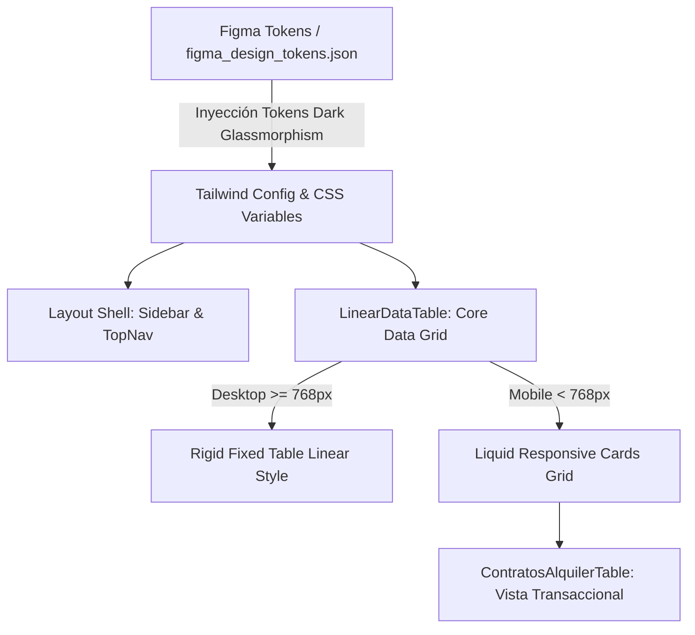

# Plan de Arquitectura e Implementación: Modernización UI/UX Nivel Enterprise (Linear Dark Glassmorphism)

## 1. Resumen de Arquitectura y Alcance
- **Especificación Asociada**: [spec.md](file:///specs/001-ui-enterprise-overhaul/spec.md)
- **Autor / Rol**: `@planner` (Software Architect + Data Engineer inyectado desde Agency Agents)
- **Revisor / QA**: `@reviewer` (UI Finish-Gate Reviewer + QA Specialist)
- **Objetivo**: Integrar la colección de tokens de **Dark Mode Glassmorphism** (Figma y CSS), desacoplar las clases hardcodeadas en blanco de los componentes de navegación ([Sidebar.tsx](file:///ferreon-erp-nextjs/src/components/ui/Sidebar.tsx) y [TopNav.tsx](file:///ferreon-erp-nextjs/src/components/ui/TopNav.tsx)) e implementar la transformación líquida a Tarjetas móviles en [LinearDataTable.tsx](file:///ferreon-erp-nextjs/src/components/ui/linear-table/LinearDataTable.tsx).

---

## 2. Desglose Arquitectónico por Capas

### Capa 1: Sistema de Diseño y Tokens Canónicos
- **Archivo**: `ferreon-erp-nextjs/figma_design_tokens.json` y `ferreon-erp-nextjs/tailwind.config.ts`.
- **Estrategia**:
  - Incorporar el grupo de tokens `theme-dark-glassmorphism` en `figma_design_tokens.json` con:
    - `bgCanvas`: `#0F172A` (o `hsl(222, 47%, 11%)`).
    - `bgSurface`: `rgba(15, 23, 42, 0.75)` con `backdrop-blur(16px)`.
    - `borderDefault`: `rgba(255, 255, 255, 0.10)`.
    - `accentCyan`: `#06B6D4` / `#0EA5E9`.
    - `accentSalmon`: `#FF8A65`.
  - En `tailwind.config.ts`, migrar `sidebar.bg`, `sidebar.hover` y `sidebar.active` a variables CSS semánticas adaptables (`bg-sidebar-bg`, `text-sidebar-fg`).

### Capa 2: Shell de Navegación (Sidebar & TopNav)
- **Archivos**: `ferreon-erp-nextjs/src/components/ui/Sidebar.tsx` y `TopNav.tsx`.
- **Estrategia**:
  - Reemplazar clases fijas `bg-white border-slate-200 text-slate-900` por clases semánticas reactivas al tema:
    - Fondo: `bg-white/90 dark:bg-slate-950/80 backdrop-blur-md`.
    - Bordes: `border-slate-200 dark:border-white/10`.
    - Textos: `text-slate-900 dark:text-slate-100`.
    - Hover en enlaces: `hover:bg-slate-100 dark:hover:bg-white/5 transition-colors duration-150`.
  - Asegurar aceleración por hardware (`transform-gpu`) para el desenfoque en navegadores móviles.

### Capa 3: Grilla de Datos y Transformación Móvil a Tarjetas (Cards)
- **Archivos**: `ferreon-erp-nextjs/src/components/ui/linear-table/LinearDataTable.tsx` y `types.ts`.
- **Estrategia**:
  - Extender la interfaz `LinearDataTableProps<T>` con una prop opcional `renderMobileCard?: (item: T, isSelected: boolean) => React.ReactNode`.
  - En el markup principal:
    - **Desktop (`hidden md:block`)**: Mantiene la tabla fija ultra-densa (30px por fila, fuentes monospaciadas en importes, Command Palette).
    - **Móvil (`block md:hidden`)**: Renderiza un contenedor vertical apilado de tarjetas (`space-y-2.5 px-1 py-2`), donde cada tarjeta muestra el identificador, cliente/obra, importe resaltado y badge de estado.
  - Si `renderMobileCard` no es suministrado, generar una tarjeta automática por defecto mapeando las columnas visibles para garantizar cero scroll horizontal en cualquier tabla sin configuración manual.

---

## 3. Análisis de Impacto y Radio de Explosión (GitNexus Blast Radius)

- **Radio de Explosión**: **BAJO A MEDIO** (Visual / UI Layer exclusivamente).
- **Archivos de Controladores y Base de Datos**: **0 archivos afectados**. Las consultas Prisma, Supabase RLS y Server Actions permanecen intactas.
- **Símbolos Afectados**:
  - `Sidebar` en `ferreon-erp-nextjs/src/components/ui/Sidebar.tsx` (Componente de Shell).
  - `TopNav` en `ferreon-erp-nextjs/src/components/ui/TopNav.tsx` (Componente de Cabecera).
  - `LinearDataTable` en `ferreon-erp-nextjs/src/components/ui/linear-table/LinearDataTable.tsx` (Componente genérico de grilla).
  - `ContratosAlquilerTable` en `ferreon-erp-nextjs/src/components/alquileres/ContratosAlquilerTable.tsx` (Consumidor principal).
- **Riesgo de Regresión**: Prácticamente nulo sobre lógica de negocio; se exige validar que las 396 pruebas existentes sigan pasando al 100%.

---

## 4. Estrategia de Pruebas (TDD)
1. **Pruebas de Componente (Vitest + React Testing Library)**:
   - Crear `LinearDataTable.responsive.test.tsx` verificando que en viewports de 375px se renderice el contenedor móvil `block md:hidden` y que la tabla tabular posea `hidden md:table`.
2. **Pruebas de Tokens**:
   - Verificar integridad del esquema JSON de `figma_design_tokens.json`.
3. **Suite Completa**:
   - Ejecutar `pnpm test` confirmando `396/396 passing`.
