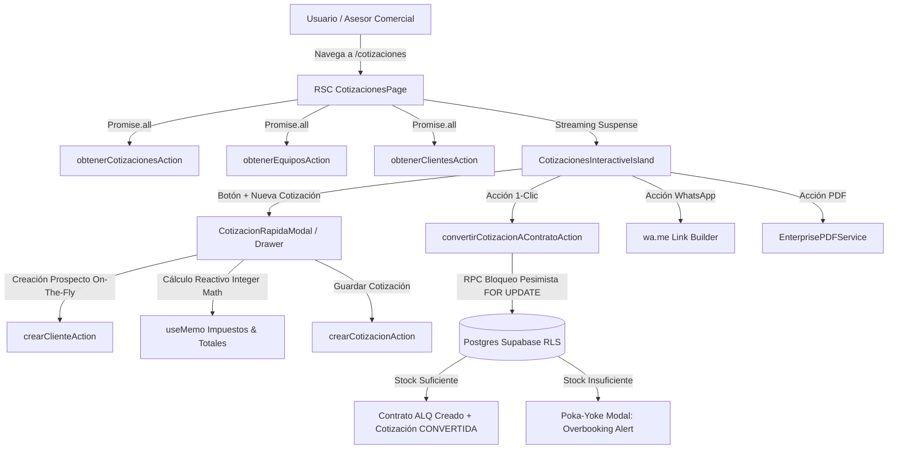

# Plan de Arquitectura Técnica: SPEC-002 Módulo de Cotizaciones Rápidas

## 1. Arquitectura del Sistema y Flujo de Datos

---

## 2. Componentes Frontend a Desarrollar / Modernizar

1. **Página de Primer Nivel (`src/app/cotizaciones/page.tsx`)**:
   - Reemplazar la redirección con un Server Component de alto rendimiento que cargue cotizaciones, equipos y clientes en paralelo.
   - Metadata de SEO y marca canónica **"Alquileres System"**.
2. **Isla de Interactividad (`src/components/cotizaciones/CotizacionesInteractiveIsland.tsx`)**:
   - Barra de métricas y KPIs comerciales (Total cotizado este mes, Tasa de conversión %, Pendientes de aprobación).
   - Filtros rápidos por estado (`TODOS`, `BORRADOR`, `ENVIADA`, `APROBADA`, `CONVERTIDA`, `RECHAZADA`).
   - Tabla responsiva Desktop con `font-mono tabular-nums` y vista líquida de Tarjetas para Móvil.
3. **Modal / Drawer de Cotización Rápida (`src/components/cotizaciones/CotizacionRapidaModal.tsx`)**:
   - Búsqueda predictiva de cliente con opción "Nuevo Prospecto Rápido" (Nombre + Teléfono).
   - Selector dinámico de equipos con indicación de stock en tiempo real (`badge` de disponibilidad).
   - Controles de días, flete, retenciones e IVA 19% con totales tabulares actualizados en tiempo real.
4. **Exportación & Compartir**:
   - Botón directo para compartir cotización formal por WhatsApp con enlace o texto con desglose limpio.
   - Generación de PDF formal con plantilla corporativa de Alquileres System.
5. **Navegación Sidebar (`src/components/ui/Sidebar.tsx`)**:
   - Registrar la entrada independiente `{ href: '/cotizaciones', icon: FileSpreadsheet, label: 'Cotizaciones', modulo: 'ALQUILERES' }`.

---

## 3. Pruebas Automatizadas TDD

1. **Unit Tests (`tests/unit/cotizaciones-rapidas.service.test.ts`)**:
   - Validación del cálculo de subtotales, IVA 19%, Retefuente 2.5%, ReteICA 0.966%, transporte y depósito de garantía con enteros.
   - Validación de generación de consecutivo `COT-XXXX`.
   - Simulación de conversión con inventario suficiente vs rechazo de sobrecupo concurrente.
2. **Integración con Vitest**:
   - Mantener las 419 pruebas actuales y añadir la suite de pruebas del módulo de cotizaciones rápidas.
