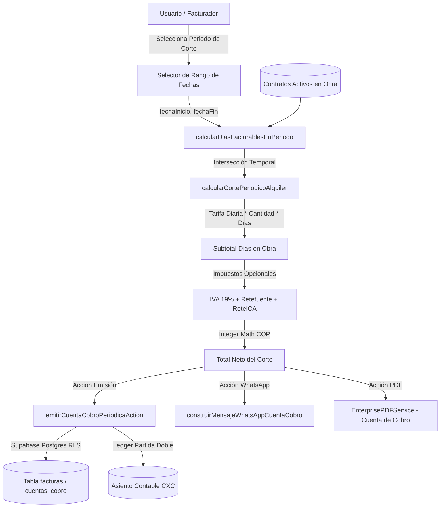

# Plan de Arquitectura Técnica: SPEC-003 Facturación Recurrente y Cuentas de Cobro

## 1. Arquitectura de Dominio y Cálculo Pro-Rata

---

## 2. Fórmulas Matemáticas de Dominio (Integer Math)

1. **Intersección de Fechas (Días Facturables)**:
   $$\text{inicioEfectivo} = \max(\text{fechaInicioCorte}, \text{fechaInicioContrato})$$
   $$\text{finEfectivo} = \min(\text{fechaFinCorte}, \text{fechaFinContrato})$$
   $$\text{dias} = \begin{cases} 0 & \text{si } \text{finEfectivo} < \text{inicioEfectivo} \\ \lfloor(\text{finEfectivo} - \text{inicioEfectivo}) / 86400000\rfloor + 1 & \text{en otro caso} \end{cases}$$

2. **Liquidación del Ítem de Maquinaria**:
   $$\text{subtotalItem} = \text{cantidad} \times \text{diasFacturables} \times \text{tarifaDiaria}$$

3. **Cálculo Tributario**:
   $$\text{valorIva} = \text{aplicaIva} ? \operatorname{round}(\text{subtotal} \times 0.19) : 0$$
   $$\text{valorRetefuente} = \text{aplicaRete} ? \operatorname{round}(\text{subtotal} \times 0.025) : 0$$
   $$\text{totalNeto} = \text{subtotal} + \text{valorIva} - \text{valorRetefuente} - \text{valorReteica}$$

---

## 3. Componentes a Integrar en el Frontend

1. **Sub-pestaña en `/facturacion`**:
   - `activeTab`: `'general' | 'cortes-periodicos'`.
2. **Panel de Control de Cortes (`src/components/facturacion/CortesPeriodicosPanel.tsx`)**:
   - Barra de filtros rápidos de periodo: *Quincena Actual (1-15 / 16-Fin)*, *Mes Actual*, *Mes Anterior*, *Rango Libre*.
   - KPIs de corte: Total a facturar en el periodo, Contratos listos para corte, Días totales de maquinaria en obra.
   - Tabla interactiva con selección múltiple (checkboxes) y previsualización de días facturables por equipo.
   - Botón de emisión en lote con confirmación y diálogo Poka-Yoke.
3. **Modal de Detalle / Emisión Individual (`src/components/facturacion/EmitirCuentaCobroModal.tsx`)**:
   - Visualización de desglose de días y equipos en obra.
   - Selector de tipo de documento: *Cuenta de Cobro Oficial* o *Factura Comercial de Venta*.
   - Botón directo de compartir por WhatsApp y descargar PDF.
