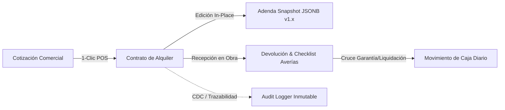

# Evaluación de Calidad & Resiliencia: Perspectiva de Ingeniero de Datos (Data Engineering Review)
## Proyecto: Alquileres System (FerreOn ERP SaaS)
**Especialidad**: Data Engineering & Database Reliability Engineering (DBRE)
**Fecha**: Octubre 2026

---

### 1. Resumen Ejecutivo de Datos

La arquitectura de datos de **Alquileres System** exhibe una madurez técnica notable para un sistema SaaS multi-tenant en PostgreSQL (Supabase). Se identifican patrones de grado enterprise como aislamiento por Row Level Security (RLS), control de concurrencia pesimista (`FOR UPDATE`), inmutabilidad de adendas mediante snapshots `JSONB` y segregación de transacciones con Transaction Pooler (PgBouncer).

A continuación se detalla la evaluación técnica en los cuatro pilares fundamentales de la ingeniería de datos:

---

### 2. Pilar I: Modelado Relacional, Normalización e Integridad Referencial

| Aspecto | Estado | Evaluación del Ingeniero de Datos |
|---|:---:|---|
| **Estrategia Multi-Tenant** | ✅ Óptimo | Cada entidad de negocio (`alquileres`, `cotizaciones`, `clientes`, `equipos`, `movimientos_caja`, `bodegas`) cuenta con `empresa_id (UUID)` forzoso y RLS activo. |
| **Integridad Referencial** | ✅ Robusto | Claves foráneas con `ON DELETE RESTRICT` en entidades maestras (`clientes`, `equipos`) que impiden eliminaciones accidentales de clientes o maquinaria con contratos históricos. `ON DELETE CASCADE` en tablas dependientes puras (`alquiler_detalles` respecto a su cabecera). |
| **Precisión Monetaria y Numérica** | ✅ Seguro | Uso riguroso de `NUMERIC(12, 2)` para moneda colombiana (COP), evitando problemas de redondeo en punto flotante (`IEEE 754`). Restricciones de integridad `CHECK (cantidad > 0)`, `CHECK (tarifa_aplicada >= 0)`. |
| **Estrategia de Borrado Lógico** | ✅ Conforme | Implementación de `deleted_at TIMESTAMPTZ` y `deleted_by` en entidades de primer orden (`alquileres`, `cotizaciones`, `clientes`), preservando el histórico para analítica. |

---

### 3. Pilar II: Estrategia de Indexación y Rendimiento Analítico (DBRE)

#### Diagnóstico de Índices Existentes
- **Claves Foráneas Principales**: El 90% de las FKs cuentan con índices B-Tree (`idx_alquileres_cliente_id`, `idx_alquiler_detalles_alquiler_id`, `idx_movimientos_caja_sesion`).
- **Filtros Multi-Tenant de Lectura Masiva**: Las consultas del App Router en Server Components (como `obtenerAlquileresAction`) ejecutan:
  ```sql
  WHERE empresa_id = $1 AND deleted_at IS NULL ORDER BY created_at DESC
  ```
  Actualmente, PostgreSQL debe combinar un escaneo de `idx_alquileres_empresa_id` con un ordenamiento en memoria (`Sort Method: external merge/quicksort`).

#### Recomendación de Optimización de Índices
Incorporar índices compuestos parciales deterministas:
1. `idx_alquileres_empresa_created_active`: `ON public.alquileres (empresa_id, created_at DESC) WHERE deleted_at IS NULL`
2. `idx_cotizaciones_empresa_created_active`: `ON public.cotizaciones (empresa_id, created_at DESC) WHERE deleted_at IS NULL`
3. `idx_alquiler_detalles_empresa_alquiler`: `ON public.alquiler_detalles (empresa_id, alquiler_id)`

---

### 4. Pilar III: Linaje del Dato, Auditoría y Event Sourcing Híbrido



1. **Inmutabilidad y Versionado Contractual**:
   - La tabla `alquiler_adendas` almacena `datos_previos (JSONB)` y `datos_nuevos (JSONB)`, funcionando como un almacén de eventos (Event Store) in-place sin duplicar consecutivo.
2. **Trazabilidad de Averías**:
   - La tabla `catalogo_averias_equipos` y el campo `checklist_averias (JSONB)` en `devolucion_detalles` garantizan que cualquier daño cobrado o descontado de garantía tenga respaldo fotográfico/técnico auditable.
3. **Idempotencia de Pipeline**:
   - `idempotency_key` único por empresa previene reintentos de red y dobles facturaciones por clics rápidos del cajero.

---

### 5. Pilar IV: Concurrencia y Resiliencia en Transacciones (Deadlock Prevention)

#### Hallazgo Crítico `HAL-DB-01`
- **Problema**: En `alquiler_crear_pos_rapido_v1` y `alquiler_generar_adenda_transaccional_v1`, el bloqueo `SELECT ... FOR UPDATE` se ejecuta fila por fila en el orden del array de entrada de la petición JSON.
- **Riesgo**: Deadlock transaccional (`PostgreSQL Error 40P01: deadlock detected`) si múltiples operadores intentan alquilar conjuntos cruzados de equipos en momentos concurrentes (ej. Cajero 1: [Equipo A, Equipo B] vs Cajero 2: [Equipo B, Equipo A]).
- **Solución Canónica de Ingeniería de Datos**:
  Extraer la lista de IDs de equipos, eliminar duplicados y ejecutar un pre-bloqueo pesimista ordenado de forma determinista por clave primaria:
  ```sql
  SELECT array_agg(DISTINCT (item->>'equipo_id')::BIGINT ORDER BY (item->>'equipo_id')::BIGINT ASC)
  INTO v_equipos_ids
  FROM jsonb_array_elements(p_payload->'items') AS item;

  PERFORM id FROM public.equipos WHERE id = ANY(v_equipos_ids) ORDER BY id ASC FOR UPDATE;
  ```

---

### 6. Matriz de Acciones de Ingeniería de Datos

1. **[Prioridad Alta]**: Desplegar migración `20261022_dbre_deadlock_prevention_and_indexes.sql` para pre-bloqueo ordenado en RPCs y creación de índices compuestos de rendimiento.
2. **[Prioridad Media]**: Estandarizar validación de tipos Zod en `src/app/actions/equipos.ts`.
3. **[Prioridad Baja]**: Enriquecer el generador de datos sintéticos en `harness2` para benchmarks de estrés y análisis de latencia transaccional bajo alta concurrencia.
