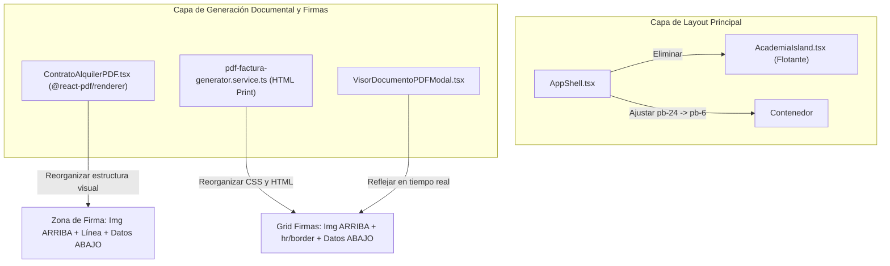

# Plan Técnico de Arquitectura (Plan): SPEC-016
# Reingeniería de Bloque de Firmas y Desacoplamiento de Widget Flotante de Experiencia

---

## 1. Arquitectura y Análisis de Impacto (Blast Radius)

### 1.1 Diagrama de Componentes Afectados



### 1.2 Radio de Impacto (Blast Radius)
- **Riesgo**: **BAJO**.
- **Módulos Afectados**:
  1. `ferreon-erp-nextjs/src/components/layout/AppShell.tsx`:
     - Retiro de `<AcademiaIsland />`.
     - Reducción de clase `pb-24 sm:pb-28` a `pb-6 sm:pb-8`.
     - *Impacto en negocio*: Cero impacto en la lógica de negocio; mejora inmediata de la ergonomía visual y legibilidad en todas las páginas.
  2. `ferreon-erp-nextjs/src/core/services/pdf-factura-generator.service.ts`:
     - Modificación de las clases `.signatures`, `.sig-line`, `.sig-img-container` y el template HTML del método `generarHTMLDocumento`.
     - *Impacto en negocio*: Cuentas de cobro, cotizaciones y contratos impresos adquieren el estándar legal colombiano (firma arriba de la línea, datos abajo).
  3. `ferreon-erp-nextjs/src/components/pdf/ContratoAlquilerPDF.tsx`:
     - Actualización de los estilos `signatures`, `sigBox`, `sigImageWrap`, `sigDividerLine` y JSX en `@react-pdf/renderer`.
     - *Impacto en negocio*: Los PDFs descargables y contratos firmados reflejan la diagramación corporativa simétrica.
  4. Suites de Pruebas:
     - `ferreon-erp-nextjs/tests/unit/pdf-firma-emisor.test.ts`: Mantener o afinar assertions para validar la nueva estructura jerárquica.
     - `ferreon-erp-nextjs/tests/components/AcademiaIsland.test.tsx` (si existe): Verificar que las pruebas unitarias sigan pasando o se actualicen.

---

## 2. Especificación Técnica de los Cambios

### 2.1 Desacoplamiento de `AcademiaIsland` en `AppShell.tsx`
- En `src/components/layout/AppShell.tsx`:
  - Remover la importación y renderizado de `<AcademiaIsland />`.
  - Preservar `<AcademiaModal />`, `<GuiaBotonesFlujosModal />` y `<CelebracionConfetti />` para que los tours y manuales interactivos puedan seguir abriéndose bajo demanda cuando el usuario lo solicite explícitamente desde el menú o TopNav.
  - Modificar el `<main>` para cambiar `pb-24 sm:pb-28` a `pb-6 sm:pb-8 md:pb-10`.

### 2.2 Reingeniería del Bloque de Firmas en `pdf-factura-generator.service.ts`
- **Antes**:
  ```html
  <div class="sig-line"> <!-- Tenía border-top aquí -->
    ${emp.razonSocial}<br/>
     <!-- Quedaba debajo del nombre -->
    <span class="sig-sub">Firma Autorizada y Sello</span>
  </div>
  ```
- **Después (Estructura Profesional)**:
  ```html
  <div class="sig-column">
    <div class="sig-image-box">
      ${emp.firmaDigitalBase64 ? `` : ''}
    </div>
    <div class="sig-line-rule"></div>
    <div class="sig-meta">
      <span class="sig-entity-name">${emp.razonSocial}</span>
      <span class="sig-sub">NIT: ${emp.nit}</span>
      <span class="sig-role-title">Firma Autorizada y Sello</span>
    </div>
  </div>
  ```
- Mismo patrón simétrico para la columna de **Cliente / Deudor**:
  ```html
  <div class="sig-column">
    <div class="sig-image-box">
      ${payload.firmaClienteBase64 ? `` : ''}
    </div>
    <div class="sig-line-rule"></div>
    <div class="sig-meta">
      <span class="sig-entity-name">Acepto y Recibí a Satisfacción</span>
      <span class="sig-sub">Cliente / Deudor: ${clienteNombre}</span>
      <span class="sig-sub">C.C. / NIT: ${payload.clienteNit || '____________________'}</span>
      ${payload.firmaClienteFecha ? `<span class="sig-sub-date">Firmado digitalmente: ${payload.firmaClienteFecha}</span>` : ''}
    </div>
  </div>
  ```

### 2.3 Reingeniería en `ContratoAlquilerPDF.tsx` (`@react-pdf/renderer`)
- Aplicar la misma división tripartita:
  1. `<View style={styles.sigImageBox}>`: Altura 32 en A5 / 42 en Carta, `justifyContent: 'flex-end'`, `alignItems: 'center'`.
  2. `<View style={styles.sigLineRule} />`: `borderTopWidth: 1`, `borderTopColor: colors.textDark`, `width: '100%'`, `marginVertical: 4`.
  3. `<View style={styles.sigMetaBox}>`: Textos de Razón Social / Acepto, NIT y rol.

---

## 3. Plan de Verificación y Quality Gates

1. **Gate 1: TDD / Vitest**:
   - Ejecutar `tests/unit/pdf-firma-emisor.test.ts` asegurando que todos los tests validen la nueva estructura y pasen en 100% verde.
2. **Gate 2: Build & Tipos**:
   - `npx tsc --noEmit` sin errores de tipado.
3. **Gate 3: Chrome DevTools MCP**:
   - Inspeccionar en pantalla de Laptop (1366x768) la ausencia del widget flotante y la ganancia de altura visual en `/alquileres`.
   - Inspeccionar modal de impresión en `VisorDocumentoPDFModal` y verificar el bloque de firmas simétrico y profesional.
   - Inspeccionar en Móvil (375px).
